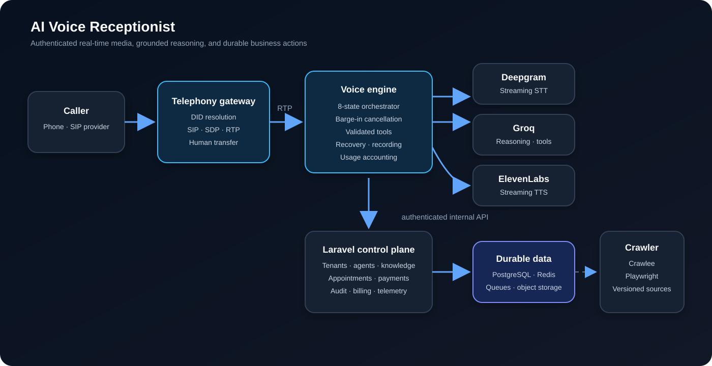

# AI Voice Receptionist

[](https://github.com/aderofrank402-spec/ai-voice-receptionist/actions/workflows/ci.yml)
[](composer.json)
[](composer.json)
[](voice-engine/src)

A multi-tenant voice automation platform that answers business calls, grounds responses in approved company knowledge, executes validated actions, and preserves a human handoff path.

The project combines a Laravel control plane with independently deployable TypeScript services for SIP/RTP telephony, streaming speech recognition, language-model orchestration, speech synthesis, website ingestion, and operational telemetry.

## What it demonstrates

- **Real-time voice pipeline:** streaming audio moves through Deepgram speech recognition, a stateful Groq-backed orchestrator, and ElevenLabs synthesis.
- **Conversation control:** an eight-state machine handles listening, reasoning, delivery, barge-in, recovery, and payment waits.
- **Grounded business context:** guided onboarding and website crawling produce structured profiles and retrieval-ready knowledge.
- **Validated actions:** tool calls check required fields before appointment, payment, or transfer operations are attempted.
- **Tenant-aware routing:** incoming numbers resolve to active business agents before a call session starts.
- **Operational accountability:** calls, provider latency, cost components, audit events, recordings, and outcomes have explicit persistence boundaries.
- **Security boundaries:** browser sessions, internal services, provider callbacks, encrypted credentials, throttling, and administrative access use separate controls.

## System at a glance



1. A SIP provider delivers an incoming call to the telephony gateway.
2. The gateway resolves the dialed number to an active tenant agent through an authenticated internal API.
3. RTP audio is streamed into the voice engine.
4. The orchestrator coordinates transcription, grounded reasoning, synthesis, interruptions, and recovery.
5. Validated tools cross the Laravel boundary for appointments, payments, call logging, or human transfer.
6. Laravel persists tenant configuration, knowledge, usage, audits, and operational state.

Read [the architecture guide](docs/ARCHITECTURE.md) for service responsibilities and call flows.

## Repository scale

| Surface | Verified repository evidence |
|---|---:|
| Tracked source and configuration files | 320 |
| PHP files | 236 |
| TypeScript files | 21 |
| Blade views | 63 |
| Database migrations | 37 |
| Automated PHP test files | 10 |
| Independently built Node services | 4 |

These figures describe the public repository snapshot, not production traffic or customer adoption.

## Product surfaces

### Business operator

- Guided onboarding and structured business-profile generation
- Agent persona, phone number, services, hours, and behavior configuration
- Website and document knowledge ingestion
- Call history, summaries, outcome tracking, and exports
- Appointment, WhatsApp, calendar, CRM, and payment integration settings
- Usage, billing, and profile controls

### Voice runtime

- Streaming STT, LLM, and TTS connections
- Sentence-buffered speech delivery and filler-audio warmup
- Barge-in detection and atomic output cancellation
- Stale-turn protection for asynchronous tool calls
- Connection health monitoring and recovery states
- DTMF-compatible transcript injection and human-transfer events
- Call recording boundary and final call persistence

### Platform administration

- Tenant, agent, call, engagement, cost, and provider-health views
- Encrypted system credentials with validation state
- Suspension controls and audit logging
- API usage, latency, budget, and system telemetry
- Queue, cache, broadcasting, and crawler operations

## Technology

- **Control plane:** PHP 8.2+, Laravel 12, Sanctum, Reverb, Pulse, Telescope
- **Web application:** Blade, Tailwind CSS, Alpine.js, Chart.js, Vite
- **Voice engine:** TypeScript, WebSockets, Deepgram, Groq, ElevenLabs
- **Telephony:** SIP, RTP, Drachtio, Fastify, provider adapter
- **Knowledge ingestion:** Crawlee, Playwright, Redis, embeddings, PostgreSQL/pgvector-ready retrieval
- **Integrations:** Google Calendar, HubSpot, WhatsApp, M-Pesa/IntaSend, Africa's Talking
- **Operations:** queues, scheduled jobs, structured logs, audit events, Docker Compose

## Trust boundaries

| Boundary | Control |
|---|---|
| Browser to Laravel | Session authentication, CSRF protection, authorization middleware |
| API consumer to Laravel | Sanctum tokens and request throttling |
| Voice/telephony service to Laravel | Shared-secret header, constant-time comparison, throttling |
| Crawler callback to Laravel | HMAC-SHA256 signature with shared-secret fallback |
| Stored provider credentials | Laravel encrypted model cast |
| Administrative actions | Admin middleware and durable audit records |
| Payment simulator | Registered only in local and testing environments |

See [the security model](docs/SECURITY_MODEL.md) and [security policy](SECURITY.md) for details and limitations.

## Local development

### Requirements

- PHP 8.2 or newer and Composer
- Node.js 20 or newer and npm
- SQLite for the default development path; PostgreSQL for vector-search behavior
- Redis when running the crawler queue
- Drachtio and SIP credentials only when exercising real telephony

### Control plane

```bash
cp .env.example .env
composer install
npm ci
php artisan key:generate
php artisan migrate
npm run build
php artisan serve
```

### Service builds

```bash
cd voice-engine && npm ci && npm run build
cd ../telephony && npm ci && npm run build
cd ../crawler && npm ci && npm run build
cd ../realtime-server && npm ci && npx tsc --noEmit
```

Copy each service's `.env.example` before running it. Use development-only keys and a test SIP account; never use real caller data in a local checkout.

## Verification

```bash
composer validate --no-check-publish
php artisan test
npm run build
php scripts/validate_public_repo.php
```

CI installs from committed lockfiles and verifies the Laravel suite, frontend bundle, voice engine, telephony gateway, crawler, realtime service, and publication-safety rules independently. Provider-dependent live calls are deliberately excluded because they require external accounts and billable network access.

## Documentation

- [Architecture and call flows](docs/ARCHITECTURE.md)
- [Security and privacy model](docs/SECURITY_MODEL.md)
- [Operations and deployment](docs/OPERATIONS.md)
- [Engineering decisions](docs/ENGINEERING_DECISIONS.md)
- [Portfolio evidence checklist](docs/EVIDENCE_CHECKLIST.md)
- [Crawler service setup](docs/CRAWL_SERVICE_SETUP.md)
- [Changelog](CHANGELOG.md)

## Evidence status

The repository currently provides source, tests, CI, architecture, and operational documentation as engineering evidence. Live screenshots and a redacted call demonstration will be added separately; no unverifiable call-volume, latency, conversion, or customer claims are made here.

## Publication safety

The public snapshot excludes production `.env` files, provider keys, caller identities, transcripts, recordings, databases, logs, runtime storage, and generated dependency directories. All committed example values are empty or development-only placeholders.

## Author

Built and maintained by [Frank Adero](https://github.com/aderofrank402-spec), a backend and AI-agent engineer focused on production systems and dependable automation.

## License

Released under the [MIT License](LICENSE).
