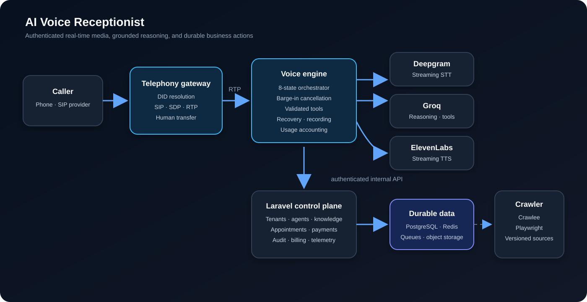

# Architecture

## Design goal

The system separates low-latency audio handling from business configuration and durable state. Provider connections can fail or reconnect without making the Laravel web application responsible for RTP timing, while business rules remain centralized behind authenticated APIs.

## Service map

| Component | Responsibility | Primary boundary |
|---|---|---|
| Laravel application | Tenant configuration, onboarding, knowledge, actions, billing, administration, durable records | HTTP, queues, relational database |
| Telephony gateway | SIP registration, inbound-call handling, DID resolution, RTP transport, transfer events | SIP/RTP and internal HTTP |
| Voice engine | STT/LLM/TTS streaming, state machine, interruption handling, validated tools, call finalization | WebSockets and internal HTTP |
| Realtime server | Earlier consolidated runtime retained as a compatibility and diagnostic surface | SIP/WebSocket/internal HTTP |
| Crawler | Website discovery, browser-backed extraction, progress callbacks | Redis work queue and signed HTTP callbacks |
| Laravel Reverb | Browser-facing realtime progress and operational updates | WebSocket |

## Incoming-call sequence

1. The SIP provider sends an `INVITE` to Drachtio and the telephony gateway.
2. The gateway extracts the dialed number and calls the protected `agents/by-number` endpoint.
3. Laravel resolves an active agent and rejects suspended tenants.
4. The gateway binds an RTP port, starts a `VoiceOrchestrator`, and answers with negotiated SDP.
5. Inbound RTP frames are copied to recording and forwarded to Deepgram.
6. Final transcript segments enter the conversation state machine.
7. Groq streams response tokens; complete sentences are forwarded to ElevenLabs.
8. Synthesized audio is emitted to the RTP bridge and returned to the caller.
9. Barge-in cancels pending generation and output using a turn counter so stale tool results cannot resume an obsolete turn.
10. Call completion closes provider connections, finalizes recording, calculates usage, and writes a durable call record.

## Conversation state machine

The voice engine exposes eight explicit states: `IDLE`, `LISTENING`, `THINKING`, `DELIVERING`, `SPEAKING`, `INTERRUPTED`, `RECOVERY`, and `AWAITING_PAYMENT`.

State transitions are observable through emitted events and guarded by watchdog timers. The turn identifier is incremented on interruption; asynchronous tool results compare their captured identifier before mutating the conversation.

## Grounding path

Structured business facts come from onboarding. Website content is collected by the crawler, versioned, chunked, and prepared for embedding-backed retrieval. `AgentContextService` combines current business facts with a small set of relevant chunks and instructs the model not to invent unavailable services.

The SQLite development path intentionally fails gracefully when vector operations are unavailable. PostgreSQL with vector support is the intended retrieval deployment path.

## Action boundary

Tool calls are schema-checked before network execution. Internal appointment, payment, configuration, call-log, and trace requests carry the service secret and are throttled by Laravel. Public API consumers use Sanctum instead of the internal secret.

Current action boundaries include durable appointment records, M-Pesa/IntaSend payment state, provider adapters, human-transfer events, and idempotent call updates keyed by external call ID.

## Failure behavior

- Missing internal secrets fail closed.
- Invalid crawler signatures return `401` before application handling.
- Suspended tenant agents cannot be resolved for calls.
- Provider errors are contained so an unhandled event does not crash the voice process.
- Stale tool calls are discarded after interruption.
- Payment waits have patience prompts and a hard timeout.

## Known deployment dependencies

End-to-end telephony requires a reachable SIP provider, Drachtio, routable RTP ports, and valid STT/LLM/TTS credentials. Retrieval quality depends on PostgreSQL vector search and completed crawl versions. Those external systems are not emulated by the repository's unit test suite.
